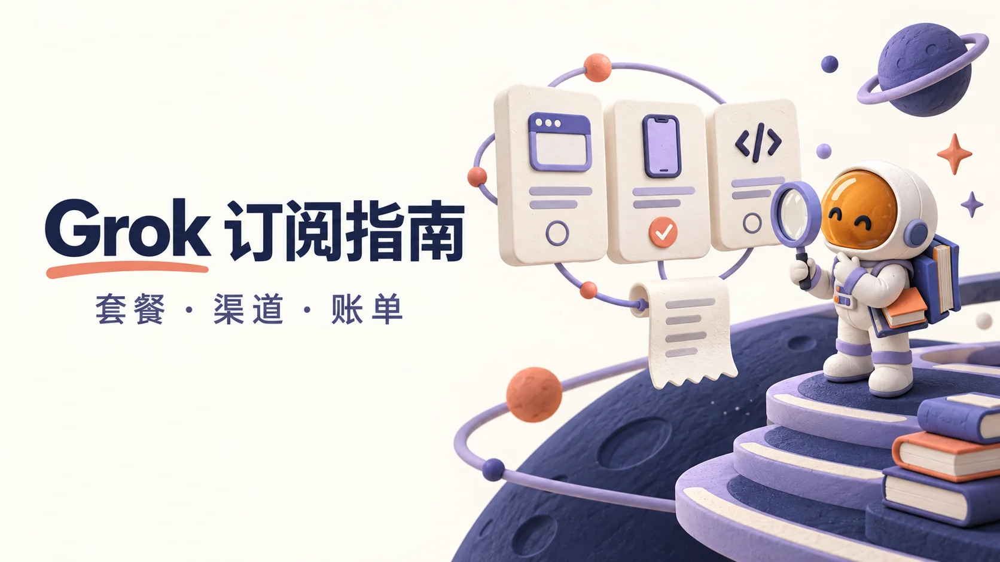

# Grok代充与订阅对比：套餐、渠道及到账核对

考虑 **Grok代充或代充值** 前，先确认买的是 Grok 会员、X 会员还是开发者 API 额度，并检查已有权益。第三方代付只是付款安排，不是官方套餐名称，也不能保证账号安全或即时到账。

> 资料核对：**2026-10-11**。本仓库是独立中文资料项目，维护者也经营第三方 AI 订阅服务；不是 xAI 或 X 官方项目。正文不推荐或链接商家；以下为公开文档核对与操作建议，未进行实购测试。

## 阅读导航

- [买的到底是什么](#买的到底是什么)
- [套餐与官方价格怎么比较](#套餐与官方价格怎么比较)
- [官网、应用商店与第三方代充的区别](#官网应用商店与第三方代充的区别)
- [付款前核对清单](#付款前核对清单)
- [Grok充值后没到账，先排查哪一步](#grok充值后没到账先排查哪一步)
- [Grok和ChatGPT、Claude、Gemini怎么比较](#grok和chatgptclaudegemini怎么比较)
- [常见问题](#常见问题)
- [官方来源与维护方式](#官方来源与维护方式)

## 买的到底是什么

| 你要解决的问题 | 先检查哪里 | 容易混淆的地方 |
|---|---|---|
| 在 Grok 网页或 App 使用会员功能 | [grok.com](https://grok.com/) 的账户与订阅页面 | 商家订单“已完成”不等于本人账号已获得约定权益 |
| 主要使用 X，也想用 Grok | X 当前会员档位及关联的 Grok 账号 | **X Premium+ 当前列有 SuperGrok 权益**，不要忽略已有权益再付款 |
| 已有会员，但用量不足 | Grok 的 Usage 页面 | 续费、升级和额外用量是不同购买对象，先看当前限制 |
| 给自己的程序接入模型，工具要求 API Key | [开发者控制台](https://console.x.ai/) 的团队、密钥与 Billing | 不要把会员状态当成指定开发者团队的可用余额证明 |

X 官方目前区分 Premium 的更高 Grok 用量与 Premium+ 的 SuperGrok 权益；**这不代表购买 SuperGrok 会反向赠送全部 X Premium+ 功能**。账号关联及实际可用权益应按官方页面核对。[X Premium 官方说明](https://help.x.com/en/using-x/x-premium)

开发者控制台有团队级预付额度和月结计费说明。接入程序前，确认使用哪个团队、哪种授权和计费方式；不要仅凭商品名含有“Grok”就购买。[API 账单文档](https://docs.x.ai/console/billing)

## 套餐与官方价格怎么比较

下面是 **2026-10-11 打开的官方网页标价快照**，用于区分产品，不是人民币报价或所有地区的最终结算价。

| 产品 | 本次核对的网页月价 | 比较时要注意 |
|---|---|---|
| SuperGrok | 30 美元 / 月 | 确认登录账号、当前套餐和账单周期 |
| SuperGrok Plus | 100 美元 / 月 | 更高价是否值得，应结合自己实际遇到的用量限制 |
| X Premium+ | 美国网页价 40 美元 / 月 | 是 X 的订阅；地区、平台及税费口径不能混用 |

来源：[Grok 官方价格页](https://x.ai/pricing)、[X 官方地区价格表](https://help.x.com/en/using-x/x-premium#pricing)。Grok 价格页也列有 Lite、Heavy 等档位；本次未取得其清晰、完整的结算口径，不沿用旧文中的价格。

比价时，建议把三个数字分开写：**一次实际付款、完整服务周期、额外费用**。年付折算的“每月价格”不能当作月付实付价；应用商店、本地币种和税费也可能改变总额。价格明显不同可以要求解释，但低价本身不足以证明盗刷，高价也不是安全证明。

## 官网、应用商店与第三方代充的区别

| 渠道 | 付款前核对 | 后续管理重点 |
|---|---|---|
| Grok 官网 | 当前账号、套餐、币种、周期与结算总额 | 保留官网账单，使用对应账户的账单管理入口 |
| Apple App Store / Google Play | 应用是否来自官方入口，以及实际订阅账号 | 先确认原始购买渠道，再按该渠道的取消与退款说明操作 |
| X Premium / Premium+ | 购买的是哪一档 X 会员，相关 Grok 权益是否已关联 | 在 X 的购买记录与对应账号中核对 |
| 第三方代充 | 服务主体、实际购买对象、所需资料、交付及售后约定 | 商家售后与官方订阅管理是两层关系，不能相互替代 |

官方 FAQ 明确列有 Web、Apple App Store 和 Google Play 的订阅管理路径。取消订阅与申请退款是不同事项，退款是否批准应看原始渠道的规则与处理结果。[Grok 官方订阅 FAQ](https://docs.x.ai/grok/faq)

本文不提供伪造地区、账单地址或绕过支付限制的步骤。支付失败时，记录实际错误和购买渠道，再查询官方支持；不能把所有失败都归结为“国内卡一定不行”。

## 付款前核对清单

无论自己订阅还是委托第三方，先把下面六件事写清楚：

- **账号归属：** 是本人现有账号、另一个成品账号，还是多人共享？谁控制登录与找回方式？不能只听商家说“用你自己的账号”，还要确认谁掌握登录和找回方式。
- **已有权益：** 有没有在网页、应用商店或 X 买过会员？关联账号是否正确？先核对，避免重复购买。
- **购买对象：** 完整套餐名称、周期、续费方式是什么？购买会员、额外用量或 API 额度，验收位置不同。
- **总成本：** 实付币种与金额、服务费、税费、是否自动续费。人民币商家报价不能冒充官方人民币定价。
- **资料权限：** 具体需要什么、为什么需要、谁会接触、何时删除？不把密码、验证码、完整 Cookie、Session 或 API Key 发到公开 Issue；不要将“无需密码”理解为完全无风险。
- **交付与售后：** 何时完成、怎样验收？未开通、买错产品、开通后中断分别怎么处理？保存付款当时的书面约定。

官方消费者条款要求不要共享账号凭据或把账号提供给他人。涉及第三方操作时，应先核对具体做法是否符合适用条款，不能把商家承诺当作官方授权。[Grok 消费者条款](https://x.ai/legal/terms-of-service)、[X 服务条款](https://x.com/en/tos)。

需要记录时，可复制[购买渠道核对卡](docs/comparison-worksheet.md#购买渠道核对卡)到自己的设备。**不要把填好的个人订单记录上传到本仓库。**

## Grok充值后没到账，先排查哪一步

| 现象 | 先做什么 | 留下什么信息 |
|---|---|---|
| 已付款，商家仍在处理 | 对照约定交付期限，通过原渠道查订单，不立即重复购买 | 订单号、付款时间、商品名称和承诺期限；仅向对应售后提供 |
| 订阅有效，但另一个入口显示未开通 | 核对最初使用的登录方式及关联账号 | 脱敏账号标识、购买渠道、状态截图 |
| 会员仍有效，但提示用量不足 | 检查 Usage 显示的限制与重置时间，再决定是否需要额外用量 | 当时用量和提示内容；不要把额度耗尽直接认定为掉订阅 |
| 程序调用失败 | 先看错误码、所选团队与账单状态，区分鉴权、限流和余额问题 | 脱敏错误信息与请求时间，不提供完整 API Key |

官方 FAQ 提醒，订阅对应购买时的账号；X 权益需要匹配关联账号。当前付费使用说明采用共享周用量，并另列 Extra Usage Credits。因此，“换个入口没显示”和“周用量已用完”需要分别排查。[Grok 账号与用量说明](https://docs.x.ai/grok/faq)

第三方标记完成后，仍应回到自己的官方账户检查约定的套餐或额度。不要仅凭对方截图验收，也不要默认所有异常都能靠刷新缓存解决。

## Grok和ChatGPT、Claude、Gemini怎么比较

不建议仅凭“某产品最强”决定长期订阅。更有用的是让候选产品完成同一组真实任务：

| 你的主要用途 | 建议的对照任务 | 重点记录 |
|---|---|---|
| 查资料、看新闻 | 同一问题、同一时间范围，逐项打开引用 | 来源是否支持结论，信息是否过期 |
| 写文章、改稿 | 同一草稿、同一要求与字数 | 事实是否保留，人工还要改多久 |
| 写代码、做表格 | 同一输入和事先写好的验收条件 | 能否运行或复算，失败能否定位 |

使用[跨模型比较记录表](docs/comparison-worksheet.md)记录模型、套餐、工具开关、费用和限制。它是空白模板，**不是已完成的测评**。先用现有权限比较；不必为了做表同时购买四家会员，也不要把一次输出当作永久排名。

## 常见问题

### Grok代充和Grok代充值，是不同套餐吗？

这两种中文说法通常都指第三方协助付款，不能据此识别官方产品。下单前要拿到完整套餐或额度名称、账号归属、周期及验收方式。

### 已经有X Premium+，还需要再买SuperGrok吗？

先核对账号关联和已有权益。当前 X 官方列明 Premium+ 包含 SuperGrok 权益，但不要据此推断它等同每一个更高档 Grok 套餐；如果已有权限能满足需求，就没有必要为了名称不同重复付款。[官方档位说明](https://help.x.com/en/using-x/x-premium)

### 买SuperGrok，就能让所有第三方API工具使用吗？

不能仅看订阅名称判断。先看工具接受哪种登录或 API 接入方式、使用哪个开发者团队，以及该计费入口显示的可用权限和额度。没有核实前，不承诺消费者会员与所有 API 用量可以通兑。

### 只交邮箱、几分钟到账，就一定可靠吗？

不能。资料要求和处理时间是具体服务的条件，不是证明授权关系、支付来源或账号安全的证据。本文不作“绝不封号”或统一到账时间承诺。

### 代充失败，一定能退款吗？

不能一概而论。先区分商家未交付、订阅已生效但不符合预期、账号或用量问题，再按购买时的规则处理；取消续费也不等于已获得退款。

## 官方来源与维护方式

- [Grok 套餐与价格](https://x.ai/pricing)
- [X Premium 档位与地区价格](https://help.x.com/en/using-x/x-premium)
- [Grok 订阅、账号与用量 FAQ](https://docs.x.ai/grok/faq)
- [开发者 API 账单文档](https://docs.x.ai/console/billing)

看到过期信息时，可提交带官方来源的修订建议。不要发布个人订单、凭据或无关广告。公开资料更新不代表我们完成了实购、后台审计或每个地区的支付测试。

本次改动见 [CHANGELOG](CHANGELOG.md)。封面为 AI 生成的示意插画，非官方素材或真实产品界面。仓库聚焦可核验的说明与比较记录，不接受刷星、虚假互动或批量推广。
